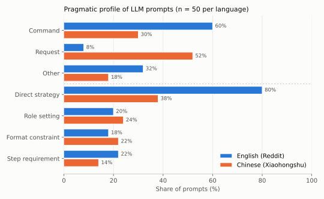

# Linguistic Differences between Chinese and English Prompts for LLMs: A Pragmatic Analysis (Xiaohongshu vs. Reddit)

**Bachelor's thesis** · BA Linguistics (Translation and Teaching Intercultural Communication)
Faculty of Foreign Languages, **Tomsk State University**, Russia · 2026
Author: **Yu Zhanbo** · Supervisor: Prof. Olga V. Nagel, Doctor of Philology

> This repository contains a summary of the thesis together with the **coded corpus** and a **reproducible analysis notebook**. The full thesis text is not published here.

**Keywords:** contrastive pragmatics · prompts · speech acts · politeness · human–AI interaction · corpus analysis · Chinese · English

---

## Overview

Prompts have become the main way ordinary users talk to large language models (LLMs). This thesis treats prompts as a new **directive register** and compares how Chinese and English users phrase them, using the tools of **contrastive pragmatics**. It asks whether users carry the politeness norms of their own language into human–AI interaction, or drop them because "it's only a machine".

## Research questions

1. **RQ1 – Speech acts and directness.** How do Chinese and English prompts differ in speech act type (command / request / suggestion / other) and in direct vs. indirect strategies?
2. **RQ2 – Metapragmatic control.** How do Chinese and English users differ in the use of **role setting** ("You are…", "Act as…"), **step requirements** ("first… then…") and **format constraints** (word limits, tables, structure)?

## Data: a 100-prompt contrastive corpus

| Language | Source | Keywords | Samples |
|---|---|---|---|
| Chinese | Xiaohongshu (小红书) | DeepSeek prompt, 豆包 prompt, AI指令, Prompt | 50 |
| English | Reddit r/ChatGPT | Prompt share, Act as, Best prompt | 25 |
| English | Reddit r/PromptEngineering | Prompt templates, AI prompt, System prompt | 25 |

- Collected manually, February–March 2026 (no scraping or API).
- Stratified by task type: creative writing and generation (35), academic learning and explanation (35), daily life (30), balanced across the two languages.
- Inclusion and exclusion criteria: complete, user-written, single-language prompts of 5–500 words or characters; no official templates, duplicates, heavy code-mixing or multi-turn fragments.

## Method

- **Coding scheme** with five dimensions, each with operational definitions and Chinese and English boundary cases:

  | Code | Dimension | Values |
  |---|---|---|
  | AP1 | Speech act type | command / request / suggestion / other |
  | AP2 | Directness strategy | direct (bare imperative) / indirect (请, 麻烦, 能不能, could you, please…) |
  | AP3 | Role assignment | yes / no |
  | AP4 | Format constraint | yes / no |
  | AP5 | Step requirement | yes / no |

- **Inter-coder reliability:** two coders double-coded 20 pilot prompts (10 Chinese, 10 English); Cohen's κ = 0.625–0.771 across dimensions (mean **κ = 0.682**, "good" agreement by Landis & Koch).
- **Analysis:** frequency comparison with chi-square tests and effect sizes (quantitative), followed by qualitative interpretation of individual prompts.
- **Theoretical framework:** Speech Act Theory (Austin, Searle), politeness theory (Leech; Brown & Levinson; Gu Yueguo), Verschueren's adaptation theory and metapragmatic awareness, and Computers Are Social Actors (CASA; Nass & Moon).

## Key findings

Figures are computed from the released coding sheet ([`analysis.ipynb`](analysis.ipynb)). Tests are chi-square tests of independence; the effect size is Cramér's V (φ for 2 × 2 tables).

| Dimension | Chinese (n = 50) | English (n = 50) | Test |
|---|---|---|---|
| Command | 30% | **60%** | AP1: χ²(2) = 23.09, p < .001, V = 0.48 |
| Request | **52%** | 8% | |
| Other (e.g. "I need…", "I want you to…") | 18% | 32% | |
| Direct strategy | 38% | **80%** | χ²(1) = 18.23, p < .001, φ = 0.43 |
| Indirect strategy | **62%** | 20% | |
| Role setting | 24% | 20% | χ²(1) = 0.23, p = .63 (n.s.) |
| Format constraint | 22% | 18% | χ²(1) = 0.25, p = .62 (n.s.) |
| Step requirement | 14% | 22% | χ²(1) = 1.08, p = .30 (n.s.) |



1. **English prompts are mostly direct commands; Chinese prompts are mostly polite requests.** English users appear to strip politeness when the addressee is an AI ("Write about productivity."), while Chinese users keep everyday politeness routines ("请帮我写一篇……").
2. **Explanation: how far politeness is grammaticalised.** In English, *please / could / would* are detachable add-ons and easy to drop. In Chinese, 请帮我 has fused into a request construction, so removing it makes the sentence sound unnatural.
3. **Metapragmatic control is largely shared.** Role setting, format constraints and step requirements show no significant difference between the languages, which suggests they are *instrumental* strategies driven by task complexity rather than culture. A small difference shows up in phrasing: English "Act as…" (a temporary role) vs. Chinese "你是…" ("you are", an assigned identity).
4. **Format constraints: no reliable difference.** The thesis text reports slightly more format constraints in Chinese prompts and reads this as a compensatory strategy of high-context communicators. The released data show no significant difference (22% vs. 18%, p = .62), so this interpretation remains a hypothesis.
5. **CASA, refined.** Users do transfer social norms to AI, but *how* they transfer them depends on language and culture: English users adapt to the addressee, while Chinese users keep the same norms.

## Contributions

- Extends contrastive pragmatics (CCSARP tradition) from human–human talk to **human–LLM prompts**.
- A reusable **five-dimension coding scheme** for prompt pragmatics that can be applied to other languages.
- Practical implications for **multilingual prompt design** and for the **localisation** of Chinese-facing AI products (e.g. better handling of indirect requests).

## Data and code

| File | Contents |
|---|---|
| [`data/prompt_corpus_coded.csv`](data/prompt_corpus_coded.csv) | 100 prompts (EN01–EN50, ZH01–ZH50) with codes on AP1–AP5; `pilot_sample` marks the 20 double-coded prompts |
| [`data/pilot_double_coding.csv`](data/pilot_double_coding.csv) | Independent codes from two coders on the 20 pilot prompts |
| [`analysis.ipynb`](analysis.ipynb) | Distributions, chi-square and Fisher tests, Cohen's κ, figure |

The prompts are short texts that users published publicly on Reddit and Xiaohongshu; no usernames or other personal information are included.

### Note on figures

The percentages above are recomputed from the released coding sheet. They differ somewhat from those printed in the thesis text. For example, the thesis reports 64% direct strategies in English prompts, while the sheet gives 80%. The direction and significance of the main findings are the same. Inter-coder reliability reproduces exactly: κ = 0.643 / 0.681 / 0.771 / 0.625 / 0.692 for AP1–AP5, with AP3 computed on 19 pairs because one code was left blank.

Data notes:

- Two English prompts (EN49, EN50) were missing from the original sheet. They were coded afterwards following the coding manual, and their `coding_note` says so.
- EN04 and EN28 are the same prompt. Removing EN28 does not change any result (see the notebook).

## Limitations and next steps

- Small corpus (100 prompts), manually collected from two platforms. Task type and platform metadata were not retained per prompt.
- Inter-coder agreement was measured on a 20-prompt pilot; the full corpus was coded by one researcher.
- Next steps: a larger corpus, a second coder for the full set, and testing whether these pragmatic differences change **LLM output quality**.

## Citation

```
Yu, Z. (2026). Linguistic Differences between Chinese and English Prompts for LLMs:
A Pragmatic Analysis (Xiaohongshu vs. Reddit). Bachelor's thesis,
Tomsk State University, Faculty of Foreign Languages.
```
